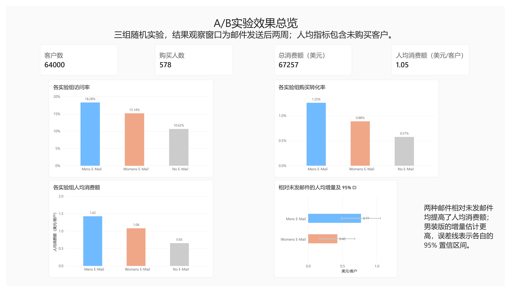
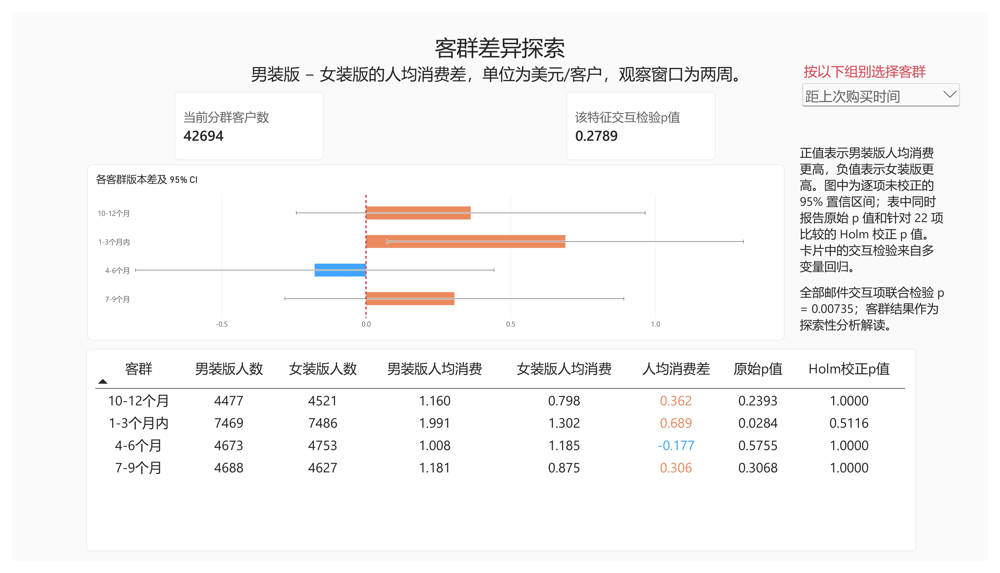

# Hillstrom 邮件营销 A/B 实验分析

基于64000名客户的随机邮件实验，使用Python分析男装版、女装版邮件对两周内访问、购买和消费的影响，并通过Power BI展示整体效果与客群差异。

**分析内容**

- 比较三组的访问率、购买转化率和人均消费额。
- 通过 Welch t 检验估计邮件相对未发邮件的人均增量销售额及95%置信区间。
- 按历史购买品类、新老客、渠道、地区、购买时间和历史消费档位分析客群差异，进行Holm多重比较校正及交互回归检验。
- 使用交互回归预测两种邮件的增量效果，模拟选择或排除10000名客户，并在留出集上评估个性化投放策略。

**主要发现**

| 邮件版本 | 相对未发邮件的人均增量（美元） |      95%置信区间 |
|---|---:|-----------------:|
| 男装版 | +0.7698 | [0.4851, 1.0545] |
| 女装版 | +0.4244 | [0.1690, 0.6799] |

两种邮件均提高了两周内的人均消费额。交互回归提供了整体客群异质性的证据，但22项组内比较经Holm校正后均未达到0.05。个性化投放策略的留出集评估对随机划分较敏感，收益尚未得到稳定验证。

**文件说明**

| 文件 | 内容 |
|---|---|
| `hillstromAB.csv` | 原始实验数据 |
| `hillstromAB实验数据分析.py` | Python 分析脚本 |
| `Customers.csv` | Power BI 使用的客户数据表 |
| `subgroup_results.csv` | 客群均值差、置信区间和检验结果 |
| `Customers.pbix` | 两页 Power BI 报表 |
| `PowerBI展示图.pdf` | 报表 PDF 展示文件 |
| `PowerBI展示图1.png`、`PowerBI展示图2.png` | 报表截图 |
| `requirements.txt` | Python 依赖清单 |

**运行方法**

在项目目录打开终端，安装依赖并运行脚本。数据文件与脚本放在同一目录，如脚本使用本地绝对路径，请按实际文件位置调整。

```bash
python -m pip install -r requirements.txt
python "hillstromAB实验数据分析.py"
```

使用 Power BI Desktop 打开 `Customers.pbix`。如需刷新数据，在数据源设置中将 CSV 路径调整为当前项目位置。

**报表预览**

第一页展示整体实验效果，第二页展示可按分群方式筛选的客群差异、置信区间和检验结果。





**数据来源**

[Kevin Hillstrom — MineThatData E-Mail Analytics and Data Mining Challenge](https://blog.minethatdata.com/2008/03/minethatdata-e-mail-analytics-and-data.html)
